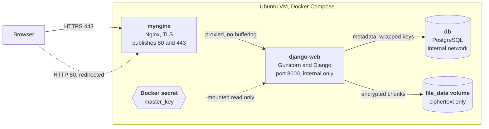

# SecureVault

A self-hosted file vault where every upload is encrypted with AES-256-GCM before it touches disk.
Django and Gunicorn behind an Nginx TLS reverse proxy, PostgreSQL for metadata, all in Docker Compose.



## Highlights

| Area | What it does |
|---|---|
| Encryption | Envelope encryption: a random key per file, wrapped by a master key held in a Docker secret. 1 MiB chunks, so a 1 GB file needs about 2 MiB of RAM. |
| Tamper detection | Chunk index and a final-chunk flag are authenticated. Reordered, truncated or modified files are rejected and nothing is sent. |
| No plaintext on disk | Raw-body upload, no proxy buffering, atomic rename of the encrypted file. |
| Access control | Per-user ownership. Other users' files return 404, and the attempt is audit-logged. |
| Hardening | Strict CSP, `Secure` and `HttpOnly` cookies, CSRF, login rate limiting, extension and magic-byte validation. |
| Network isolation | Only Nginx publishes ports. The database sits on an internal network with no outside route. |
| Large files | 1 GiB limit enforced in Nginx and Django, with timeouts tuned for slow links. |

## Quick start (Ubuntu VM)

```bash
sudo apt install -y docker.io docker-compose-v2 openssl     # if not installed
VM_IP=192.168.64.2                                           # your VM's address
./scripts/gen_secrets.sh $VM_IP    # master key and .env with random values
./scripts/gen_certs.sh   $VM_IP    # self-signed TLS certificate
docker compose up -d --build
```

Open `https://<VM_IP>/`, accept the self-signed certificate warning, and register a user.
Back up `secrets/master_key.txt`: if it is lost, every stored file is unrecoverable.

Run the tests (34) locally:

```bash
python3 -m venv .venv && . .venv/bin/activate && pip install -r app/requirements.txt
cd app && DJANGO_SECRET_KEY=x USE_SQLITE=1 python manage.py test vault
```

## Try the security features

```bash
./scripts/show_ciphertext.sh <file_id>                                     # hexdump: random-looking bytes
docker compose exec django-web python manage.py tamper_file <file_id>      # corrupt a stored file
```

After tampering, the next download is rejected and a `Download failed` entry appears on the Activity page.
Requesting another user's `/files/<id>/download/` returns 404, and five wrong passwords trigger a
15 minute lockout for that IP (`429`).

## Documentation

| Document | Contents |
|---|---|
| [docs/ARCHITECTURE.md](docs/ARCHITECTURE.md) | Upload and download workflows, security controls, known limitations |
| [docs/ENCRYPTION.md](docs/ENCRYPTION.md) | Key hierarchy, nonce and AAD scheme, design rationale |
| [docs/BENCHMARKS.md](docs/BENCHMARKS.md) | Benchmark tools, procedure and measurement notes |

## Project layout

```
docker-compose.yml     3 services (mynginx, django-web, db), 2 networks, 2 volumes, 1 secret
nginx/                 TLS, security headers, rate limit, proxy settings
app/                   Dockerfile, Django project (config/) and the vault app
  vault/crypto.py      envelope encryption and chunked AES-GCM (start here)
  vault/views.py       upload, download, delete, ownership checks
  vault/tests.py       34 tests
  tailwind/            build setup for the self-hosted stylesheet and fonts
scripts/               cert and secret generation, ciphertext hexdump, benchmarks
docs/                  architecture, encryption and benchmark documentation
```

## Known limitations

- A compromised running `django-web` container holds the master key in memory and can decrypt every file.
- The certificate is self-signed, so browsers warn and there is no identity assurance.
- File names, sizes and upload times are stored in plaintext; only contents are encrypted.
- No malware scanning, quotas or email verification, and registration is open.
- Single node, with no key rotation tool (the schema supports it).

The full list is in [docs/ARCHITECTURE.md](docs/ARCHITECTURE.md#known-limitations).

Deployment was tested on an Ubuntu 24.04 VM (UTM on Apple M4, 2 vCPU, 3.8 GB RAM).
