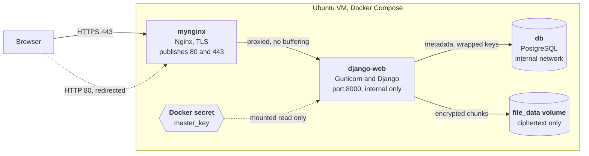
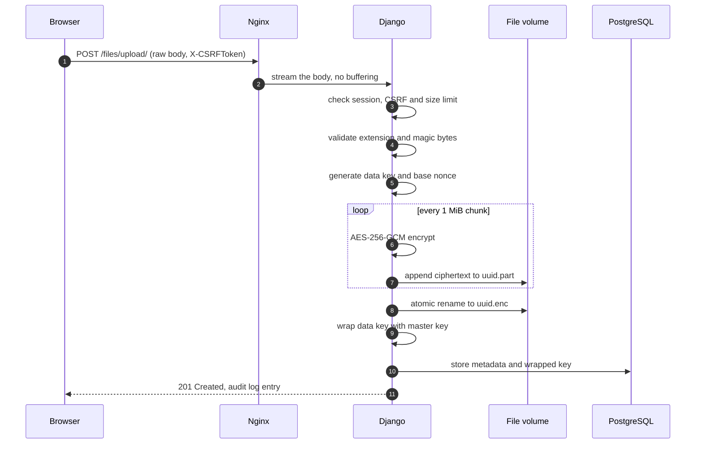
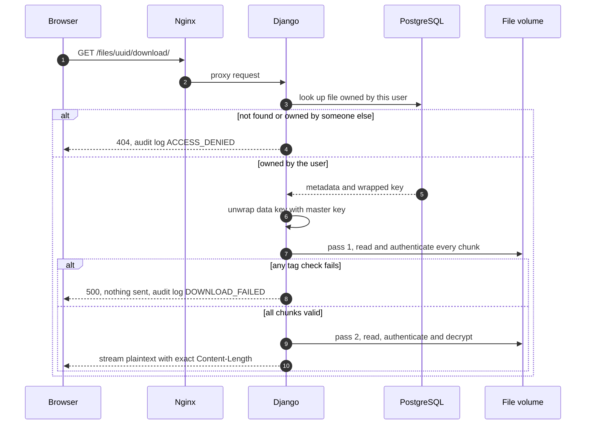
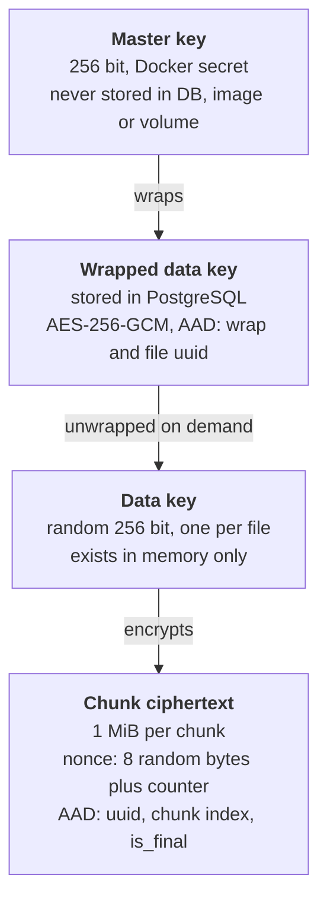

# SecureVault

An encrypted file upload and download service. Django and Gunicorn run behind an Nginx TLS reverse proxy,
with PostgreSQL for metadata, all orchestrated with Docker Compose. Every uploaded file is encrypted with
AES-256-GCM (chunked, streaming, envelope encryption) before it is written to disk.

## System design



Only `mynginx` publishes ports. `django-web` exposes port 8000 to the Compose network only. `db` sits on an
`internal: true` network with no route to the outside, and the ciphertext volume is mounted only into `django-web`.

### Upload workflow



### Download workflow



### Key hierarchy



## Features

- Registration, login and logout, with per-user file ownership.
- Upload (up to 1 GiB), list, details, download and delete.
- Authenticated encryption of file contents with per-file keys.
- Extension whitelist and magic-byte validation.
- Login rate limiting, CSRF protection, secure cookies and a strict Content Security Policy.
- Audit log of security-relevant events.
- Server-rendered UI with a locally compiled Tailwind stylesheet (no CDN at runtime).
- Helper tools: `tamper_file` management command, ciphertext hexdump script, benchmark tools.

## Repository layout

```
.
├── docker-compose.yml          3 services, 2 networks, 2 volumes, 1 secret
├── .env.example                template for .env (Django secret, DB password, hosts, limits)
├── nginx/
│   ├── nginx.conf              HTTP to HTTPS redirect, TLS, security headers, rate limit, 1 GB limit
│   ├── proxy_django.conf       shared proxy settings (streaming, no buffering, real-IP headers)
│   └── certs/                  server.crt and server.key (generated, git-ignored)
├── secrets/master_key.txt      AES master key, mounted as a Docker secret (generated, git-ignored)
├── scripts/
│   ├── gen_certs.sh            self-signed certificate with SANs
│   ├── gen_secrets.sh          master key and .env with random secrets
│   ├── make_submission.sh      builds dist/securevault-submission-*.zip (no secrets, certs or data)
│   ├── benchmark.py            end-to-end upload/download benchmark and matplotlib charts
│   ├── requirements-bench.txt  matplotlib (charts only)
│   └── show_ciphertext.sh      hexdump a stored file to show that it is ciphertext
└── app/
    ├── Dockerfile  entrypoint.sh  requirements.txt
    ├── tailwind/               package.json, lockfile, config, input.css; the Docker build compiles
    │                           tailwind.css and copies the self-hosted IBM Plex fonts (copy-fonts.js)
    ├── config/                 settings.py (security settings), urls.py, wsgi.py
    └── vault/
        ├── crypto.py           envelope encryption and chunked AES-GCM (start here)
        ├── validators.py       extension whitelist, magic bytes, filename cleaning
        ├── views.py            upload, list, details, download, delete, auth views
        ├── models.py           EncryptedFile (crypto metadata), AuditLog
        ├── audit.py, signals.py  audit helper, login/logout events, login lockout counter
        ├── management/commands/tamper_file.py   corrupts a stored ciphertext (demo helper)
        ├── management/commands/bench_crypto.py  encrypt/decrypt-only timing (real crypto.py, no network)
        ├── benchutil.py        sizes, statistics, CSV output and CPU/RAM detection for the benchmark tools
        ├── templates/, static/vault/{upload.js,app.js}
        └── tests.py            34 tests (crypto, validators, ownership, tampering, rate limit, and more)
```

## Deployment (Ubuntu VM)

```bash
sudo apt install -y docker.io docker-compose-v2 openssl     # if not installed
VM_IP=192.168.64.2                                           # the VM's IP address or hostname
./scripts/gen_secrets.sh $VM_IP          # secrets/master_key.txt and .env (random values)
./scripts/gen_certs.sh   $VM_IP          # nginx/certs/server.{crt,key}
docker compose up -d --build
docker compose exec django-web python manage.py createsuperuser   # optional: /admin/ shows the audit table
```

Open `https://<VM_IP>/`, accept the self-signed certificate warning, and register a user.
HTTP on port 80 redirects to HTTPS.

The VM address must be listed in `DJANGO_ALLOWED_HOSTS` and `DJANGO_CSRF_TRUSTED_ORIGINS`.
`gen_secrets.sh` sets both from the address it is given; `.env.example` shows the format.

The Tailwind stylesheet is compiled during `docker build` in a throw-away Node stage, and the final image
contains no Node. The VM therefore needs access to the npm registry at build time only. Nothing is loaded
from a CDN at runtime: the stylesheet and the IBM Plex fonts are served from `/static/`.

Back up `secrets/master_key.txt`. If it is lost, every stored file is permanently unrecoverable.

### Tests

The container filesystem is read-only, so the test suite runs in a local virtual environment:

```bash
python3 -m venv .venv && . .venv/bin/activate && pip install -r app/requirements.txt
cd app && DJANGO_SECRET_KEY=x USE_SQLITE=1 python manage.py test vault
```

### Submission archive

`./scripts/make_submission.sh` writes `dist/securevault-submission-<timestamp>.zip`. The archive excludes `.env`,
`secrets/`, `nginx/certs/`, storage data and `__pycache__`, and the script fails if any real secret value is
found inside it.

## Usage walkthrough

1. Upload a PDF or ZIP by drag and drop. The progress bar completes and the file is marked as encrypted.
2. Open Details to see the algorithm, base nonce, wrapped key, original and encrypted size (16 bytes of
   overhead per chunk), and the first 64 bytes on disk (random-looking, with no `%PDF` header).
3. Inspect the stored ciphertext on the server: `./scripts/show_ciphertext.sh` lists files, and
   `./scripts/show_ciphertext.sh <file_id>` prints a hexdump.
4. Download the file. It is byte-identical to the original.
5. Tamper with the stored file:
   `docker compose exec django-web python manage.py tamper_file <file_id>`.
   The next download is rejected and no data is sent; a `Download failed` row appears on the Activity page.
   Running the command again restores the file (the XOR is applied twice), and `--truncate 16` tests truncation.
6. Ownership: log in as a second user and request the first user's `/files/<id>/download/` URL. The response is
   404, and the attempt is recorded as `Failed access` under the second user (visible on their Activity page and,
   for a superuser, in the full table under `/admin/`).
7. Rate limit: after 5 wrong passwords, the 6th attempt receives `429` even with the correct password and is
   logged as `LOGIN_BLOCKED`. The lockout applies per client IP address and lasts 15 minutes.

## Benchmarks

Two complementary measurements, with 5 runs each for 10 MB, 100 MB, 500 MB and 1 GB. Sizes are decimal
(1 GB = 1,000,000,000 bytes, which is under the application's 1 GiB limit). Results are the mean and the
sample standard deviation (n-1), written to CSV together with the CPU model, core count and RAM of the machine.

| Tool | Measures | Runs on |
|---|---|---|
| `scripts/benchmark.py run` | Upload and download through the whole stack (TLS, Nginx, Gunicorn, Django, AES-GCM, disk). Download verifies SHA-256, and every test file is deleted through the application afterwards. | The VM, against `https://localhost` |
| `manage.py bench_crypto` | Encryption and decryption only, using the real `vault/crypto.py` functions, with no network and no database. | Inside `django-web` on the VM, and directly on the host machine |

The end-to-end benchmark was run on the VM against `https://localhost`. Client and server therefore share the
VM's CPU and the traffic never crosses a physical network, so the results exclude network latency and bandwidth limits.

### Setup

The end-to-end benchmark needs only Python 3 (standard library) and is run from a checkout of the project on the
VM. Generating charts and running `bench_crypto` on a physical host need a virtual environment with matplotlib,
Django and `cryptography`:

```bash
python3 -m venv .venv && . .venv/bin/activate
pip install -r app/requirements.txt -r scripts/requirements-bench.txt
```

### Procedure

1. End to end, on the VM. Use a dedicated test account; `--register` creates it on first use. The password is read
   from `BENCH_PASSWORD` (or prompted for) so that it never appears on the command line. About 1 GB of local disk
   is needed, since one test file exists at a time.
   ```bash
   BENCH_PASSWORD='choose-a-test-password' python3 scripts/benchmark.py run \
       --base-url https://localhost --username benchuser --register --label vm
   ```
   Output: `bench_out/network_summary.csv`. For a quick trial, add `--sizes 10MB,100MB --runs 2`.
2. Crypto only, on the VM, inside the container. The CSV goes to stdout and progress to stderr:
   ```bash
   mkdir -p bench_out
   docker compose exec -T django-web python manage.py bench_crypto --label vm \
       --tmpdir /data/files --csv - > bench_out/crypto_vm.csv
   ```
   `--tmpdir /data/files` places the temporary ciphertext on the persistent disk volume, because the container's
   `/tmp` is RAM-backed. The temporary file is removed after every run and needs about 1 GB free on that volume.
3. Crypto only, on the physical host:
   ```bash
   cd app && DJANGO_SECRET_KEY=x USE_SQLITE=1 python manage.py bench_crypto --label physical \
       --csv ../bench_out/crypto_physical.csv && cd ..
   ```
4. Charts (PNG, 200 dpi; bars show the mean, error bars the standard deviation; logarithmic time axis). Copy the
   two VM CSVs (`network_summary.csv`, `crypto_vm.csv`) into the `bench_out/` directory of the machine that draws
   the charts, for example with `scp`, then run:
   ```bash
   python3 scripts/benchmark.py plot --network bench_out/network_summary.csv \
       --crypto bench_out/crypto_vm.csv bench_out/crypto_physical.csv
   ```
   This produces `bench_out/charts/network_upload_download.png` (time and throughput),
   `crypto_encrypt_decrypt.png` (one panel per machine) and `crypto_vm_vs_physical.png`.

Each tool prints the CPU model, core count and RAM of the machine it runs on, and every CSV row repeats them.
If a Linux/ARM VM reports only a hardware identifier instead of a CPU name, set the name explicitly with
`BENCH_CPU_MODEL="Apple M4 (UTM, 2 vCPU)"`. Inside the container, use
`docker compose exec -T -e BENCH_CPU_MODEL="..." django-web python manage.py bench_crypto ...`.

### Measurement notes

- Upload time runs from the first request byte to the last response byte. It includes the TLS and HTTP transfer,
  Nginx, server-side encryption and the disk write. Download time runs from the request to the last byte and
  includes the server's up-front integrity pass (the application decrypts twice: once to verify, once to stream).
  Local file reads (upload) and SHA-256 hashing (download) are measured separately and excluded. The TLS handshake
  completes before the timer starts. `bench_crypto` excludes disk reads and writes and the plaintext comparison.
- Each run uses a fresh random key and nonce, as the application does for every file. One untimed 1 MB warm-up
  cycle runs first; `--no-warmup` skips it.
- For comparable results, run on mains power with no heavy background load, and keep the VM otherwise idle.
- The script disables TLS verification because the VM certificate is self-signed. The setting is confined to
  `benchmark.py`.
- Crypto-only throughput (GB/s with AES hardware instructions) is expected to be far above end-to-end throughput,
  because the latter also includes TLS, HTTP handling, Python and disk I/O.

## Encryption design

| Item | Choice |
|---|---|
| Cipher | AES-256-GCM (`cryptography.hazmat.primitives.ciphers.aead.AESGCM`), authenticated encryption |
| Key hierarchy | A random 256-bit data key per file, wrapped with AES-256-GCM by the master key |
| Master key | Docker secret `/run/secrets/master_key` (or the `MASTER_KEY` environment variable in development), base64, validated at startup; never stored in the image, the database or the file volume |
| Chunking | 1 MiB of plaintext per chunk, so a 1 GB file needs about 2 MiB of RAM rather than 1 GB |
| Nonce (96 bit) | 8 random bytes (stored in the database) followed by a 32-bit chunk counter, unique per chunk |
| AAD per chunk | `file_uuid ‖ chunk_index (64-bit) ‖ is_final (1 byte)` |
| Wrapped-key AAD | `"wrap:" ‖ file_uuid` |
| Stored in the database | Base nonce, wrapped key, wrap nonce, sizes, chunk size and count, algorithm, master-key version |
| On disk | `<uuid>.enc` in a private volume, laid out as `chunk0 ‖ tag0 ‖ chunk1 ‖ tag1 ...`, with no header and no original name |

### Design rationale

**Envelope encryption.** A per-file key limits the impact of a key compromise to one file and keeps the GCM
requirement of never reusing a (key, nonce) pair easy to satisfy. It also allows master-key rotation by
re-wrapping 48-byte keys (the `master_key_version` column) instead of re-encrypting stored data. Cloud KMS
services work the same way, so the master key could later move into a KMS or HSM without changing the file format.

**Nonce stored in the database.** Nonces must be unique, not secret. A database compromise alone yields wrapped
keys and nonces, which are useless without the master key, and a disk compromise alone yields only ciphertext.
Decryption requires the database, the secret and the volume together.

**Chunked encryption.** Encrypting a file in one GCM call requires the whole file in memory (1 GB per worker), and
GCM is limited to roughly 64 GiB per nonce. Chunking bounds memory use and makes the nonce scheme explicit.

**Nonce construction.** A random 96-bit nonce has a non-negligible collision probability after about 2^32 uses
under one key. Here every chunk under a key has a distinct counter value, so uniqueness holds by construction, and
the key is per-file in any case.

**Reordering, truncation and transplanting.** The chunk index is part of both the nonce and the authenticated
data, so moving chunk 3 to position 2 fails the tag check. The final chunk is sealed with `is_final=1`: if the
tail is dropped, the new last chunk was sealed with `is_final=0` and fails verification, and appended data fails
as well. The file UUID in the AAD prevents a valid chunk from being transplanted into another file. `tests.py`
contains a test for each case.

**No partial plaintext on failure.** Download is two-pass. Pass 1 authenticates every chunk and discards the
plaintext, using constant memory. Only if it succeeds does pass 2 stream-decrypt to the client. Pass 2
re-authenticates each chunk in case the file changed in between, and the response carries an exact
`Content-Length`, so an aborted stream appears to the client as an incomplete download and never as a complete,
shorter file. The cost is one extra sequential read and AES pass, which AES-NI makes inexpensive. Decrypting to a
temporary file first was rejected because it would place plaintext on disk.

**Plaintext never reaches disk.** The browser sends the raw file as the request body rather than multipart form
data, which Django would spool to `/tmp`. Nginx runs with `proxy_request_buffering off` and `proxy_buffering off`,
so it does not spool to its own temporary directory either. Django encrypts chunk by chunk directly into
`<uuid>.part` and then renames it atomically to `.enc`. The container root filesystem is read-only and `/tmp` is
a tmpfs.

**Deletion.** The database row is removed first, which destroys the wrapped key (crypto-shredding). Even if blocks
remain on disk or in a volume backup, they cannot be decrypted. The file is then unlinked.

**Ownership.** A single function, `get_owned_file()`, filters by `pk` and `owner=request.user` for details,
download and delete. A foreign file and a non-existent file are indistinguishable (404), and the attempt is
recorded as `ACCESS_DENIED`. File IDs are random UUIDs as a second layer, but the ownership check is the control.

**Validation.** An extension whitelist is combined with magic-byte checks on the first chunk (PDF `%PDF-`, PNG,
JPEG, GIF, ZIP and Office `PK\x03\x04`, MP4 `ftyp`; `.txt` and `.csv` must be NUL-free UTF-8). Files are always
served as `application/octet-stream` with `Content-Disposition: attachment` and `nosniff`, so an uploaded HTML or
SVG file cannot execute in the application's origin. Magic bytes verify only the start of a file; this is not
malware scanning (see Known limitations).

**Size limit.** The 1 GiB limit is enforced twice. Nginx applies `client_max_body_size 1g` to `/files/upload/`
only, and every other URL is capped at 1 MB. Django checks `Content-Length` and also counts bytes as they stream,
so a client that misreports its length cannot exceed the limit.

**Timeouts for large transfers.** Nginx `client_body_timeout`, `proxy_send_timeout`, `proxy_read_timeout` and
`send_timeout` measure idle gaps between two reads or writes, not total duration, so a slow but steady transfer
does not hit them. They are set to 3600 s on the upload and download routes only; all other routes use 15 to 60 s,
which cuts off slow-body attacks elsewhere. Gunicorn's `--timeout 3600` is a worker heartbeat limit, and with the
`gthread` worker class the heartbeat comes from the main thread, so long requests do not trip it (verified: a 12 s
upload survived `--timeout 5`). The 3600 s `proxy_read_timeout` on the download route also covers the silent
integrity pass before the first byte is sent.

**Rate limiting.** Two layers apply. Nginx `limit_req` allows 30 requests per minute per IP on login URLs, and
Django locks out an IP after 5 failed logins in 15 minutes. The Django counter is read from the audit table, so it
works across all Gunicorn workers without Redis. The lockout is per IP rather than per username, so an attacker
cannot lock a victim out of their own account.

**Trusting `X-Real-IP`.** Nginx overwrites the header with `$remote_addr`, and Django honours it only if the TCP
peer is the Nginx container (`TRUSTED_PROXY_HOSTS=mynginx`, resolved through Docker DNS, cached for 30 s, failing
closed; `TRUSTED_PROXY_CIDRS` is optional). Headers from any other peer are ignored, and a value that is not a
single valid IP falls back to the peer address. Without this, every user would appear as the Nginx container's
address, and one attacker's failed logins would lock out everyone.

**Cookies and CSRF.** Cookies are `Secure`, `HttpOnly`, `SameSite=Lax` and `__Host-` prefixed. CSRF middleware
covers every POST, including the XHR upload, which sends its token in the `X-CSRFToken` header. `DEBUG=False`, and
secrets come only from `.env` or the Docker secret.

**Content Security Policy.** `default-src 'self'; script-src 'self'; style-src 'self'; ...; frame-ancestors 'none';
object-src 'none'`. There are no external hosts and no `'unsafe-inline'`: the JavaScript lives in `/static`, and
Tailwind is compiled to a static CSS file at build time. The progress bar sets `element.style.width` from
JavaScript, which CSP permits (it blocks only inline `style=""` attributes and `<style>` elements in markup).
Django's `/admin/` is served under the same policy, so some widgets there may lose minor cosmetic styling.

**Master key as a Docker secret.** Environment variables are exposed through `docker inspect`,
`/proc/<pid>/environ`, crash dumps and child processes, whereas a secret is a file visible only to the container
that mounts it. With plain Compose the secret is a bind mount of `secrets/master_key.txt`, protected by host file
permissions; Swarm, Kubernetes or a KMS would give stronger guarantees.

**Audit log.** Events: `UPLOAD`, `DOWNLOAD`, `DELETE`, `ACCESS_DENIED`, `DOWNLOAD_FAILED`, `UPLOAD_REJECTED`,
`LOGIN`, `LOGIN_FAILED`, `LOGIN_BLOCKED`, `LOGOUT`, `REGISTER`. Each record holds the user, a username snapshot,
the IP, the file ID and name, and a timestamp. The file ID is a plain UUID rather than a foreign key, so records
survive file deletion, and the admin view is read-only.

**User interface.** A single light theme with a restricted palette: `tailwind.config.js` replaces Tailwind's
defaults so that only the named color roles exist, and text contrast is 5.2:1 or better. Rows are separated by
hairline rules instead of boxed cards. One accent color (green) marks encrypted and verified state and is also the
focus ring, and red is reserved for failures. The UI uses no gradients, glass effects or decorative shadows,
respects `prefers-reduced-motion`, and stacks table rows on narrow screens.

## Known limitations

- A compromised running `django-web` container holds the master key in memory and can decrypt every file.
  Encryption at rest protects against stolen disks, backups and database dumps, not against a fully compromised
  application. A KMS or HSM would narrow this exposure.
- The client IP comes from Docker's NAT. On Ubuntu with IPv4 the real source address is preserved, but connections
  arriving over IPv6 through Docker's userland proxy may show the bridge gateway instead. When testing the
  lockout, use a client on a separate machine.
- The certificate is self-signed, so browsers show a warning and there is no identity assurance. Browsers honour
  HSTS only after they have seen a trusted certificate.
- There is no malware scanning, quota system or email verification, and registration is open to anyone.
- File names, sizes and upload times are stored in plaintext in the database; only file contents are encrypted.
- `tamper_file` is a demonstration helper and should be removed from any real deployment.
- The system is single-node. No key rotation tool is included, although the schema supports rotation through
  `master_key_version`.
- Deployment was tested on an Ubuntu 24.04 VM (UTM on Apple M4, 2 vCPU, 3.8 GB RAM). Two issues were found and
  fixed during deployment: the Nginx download-route regex had to be quoted because it contains `{36}`, and the
  VM's IP had to be added to `DJANGO_ALLOWED_HOSTS` and `DJANGO_CSRF_TRUSTED_ORIGINS`.
