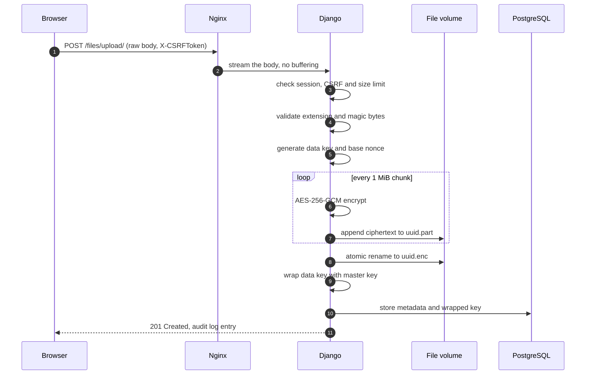
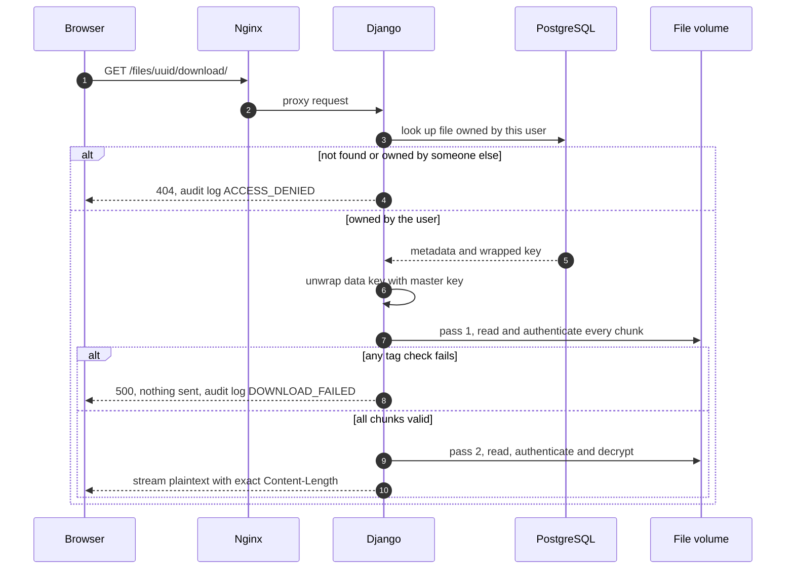

# Architecture and security controls

See the [README](../README.md) for the system diagram and [ENCRYPTION.md](ENCRYPTION.md) for the cryptographic design.

## Upload workflow

## Download workflow

## Design rationale

**Ownership.** A single function, `get_owned_file()`, filters by `pk` and `owner=request.user` for details,
download and delete. A foreign file and a non-existent file are indistinguishable (404), and the attempt is
recorded as `ACCESS_DENIED`. File IDs are random UUIDs as a second layer, but the ownership check is the control.

**Validation.** An extension whitelist is combined with magic-byte checks on the first chunk (PDF `%PDF-`, PNG,
JPEG, GIF, ZIP and Office `PK\x03\x04`, MP4 `ftyp`; `.txt` and `.csv` must be NUL-free UTF-8). Files are always
served as `application/octet-stream` with `Content-Disposition: attachment` and `nosniff`, so an uploaded HTML or
SVG file cannot execute in the application's origin. Magic bytes verify only the start of a file; this is not
malware scanning (see Known limitations).

**Size limit.** The 1 GiB limit is enforced twice. Nginx applies `client_max_body_size 1g` to `/files/upload/`
only, and every other URL is capped at 1 MB. Django checks `Content-Length` and also counts bytes as they stream,
so a client that misreports its length cannot exceed the limit.

**Timeouts for large transfers.** Nginx `client_body_timeout`, `proxy_send_timeout`, `proxy_read_timeout` and
`send_timeout` measure idle gaps between two reads or writes, not total duration, so a slow but steady transfer
does not hit them. They are set to 3600 s on the upload and download routes only; all other routes use 15 to 60 s,
which cuts off slow-body attacks elsewhere. Gunicorn's `--timeout 3600` is a worker heartbeat limit, and with the
`gthread` worker class the heartbeat comes from the main thread, so long requests do not trip it (verified: a 12 s
upload survived `--timeout 5`). The 3600 s `proxy_read_timeout` on the download route also covers the silent
integrity pass before the first byte is sent.

**Rate limiting.** Two layers apply. Nginx `limit_req` allows 30 requests per minute per IP on login URLs, and
Django locks out an IP after 5 failed logins in 15 minutes. The Django counter is read from the audit table, so it
works across all Gunicorn workers without Redis. The lockout is per IP rather than per username, so an attacker
cannot lock a victim out of their own account.

**Trusting `X-Real-IP`.** Nginx overwrites the header with `$remote_addr`, and Django honours it only if the TCP
peer is the Nginx container (`TRUSTED_PROXY_HOSTS=mynginx`, resolved through Docker DNS, cached for 30 s, failing
closed; `TRUSTED_PROXY_CIDRS` is optional). Headers from any other peer are ignored, and a value that is not a
single valid IP falls back to the peer address. Without this, every user would appear as the Nginx container's
address, and one attacker's failed logins would lock out everyone.

**Cookies and CSRF.** Cookies are `Secure`, `HttpOnly`, `SameSite=Lax` and `__Host-` prefixed. CSRF middleware
covers every POST, including the XHR upload, which sends its token in the `X-CSRFToken` header. `DEBUG=False`, and
secrets come only from `.env` or the Docker secret.

**Content Security Policy.** `default-src 'self'; script-src 'self'; style-src 'self'; ...; frame-ancestors 'none';
object-src 'none'`. There are no external hosts and no `'unsafe-inline'`: the JavaScript lives in `/static`, and
Tailwind is compiled to a static CSS file at build time. The progress bar sets `element.style.width` from
JavaScript, which CSP permits (it blocks only inline `style=""` attributes and `<style>` elements in markup).
Django's `/admin/` is served under the same policy, so some widgets there may lose minor cosmetic styling.

**Audit log.** Events: `UPLOAD`, `DOWNLOAD`, `DELETE`, `ACCESS_DENIED`, `DOWNLOAD_FAILED`, `UPLOAD_REJECTED`,
`LOGIN`, `LOGIN_FAILED`, `LOGIN_BLOCKED`, `LOGOUT`, `REGISTER`. Each record holds the user, a username snapshot,
the IP, the file ID and name, and a timestamp. The file ID is a plain UUID rather than a foreign key, so records
survive file deletion, and the admin view is read-only.

**User interface.** A single light theme with a restricted palette: `tailwind.config.js` replaces Tailwind's
defaults so that only the named color roles exist, and text contrast is 5.2:1 or better. Rows are separated by
hairline rules instead of boxed cards. One accent color (green) marks encrypted and verified state and is also the
focus ring, and red is reserved for failures. The UI uses no gradients, glass effects or decorative shadows,
respects `prefers-reduced-motion`, and stacks table rows on narrow screens.

## Known limitations

- A compromised running `django-web` container holds the master key in memory and can decrypt every file.
  Encryption at rest protects against stolen disks, backups and database dumps, not against a fully compromised
  application. A KMS or HSM would narrow this exposure.
- The client IP comes from Docker's NAT. On Ubuntu with IPv4 the real source address is preserved, but connections
  arriving over IPv6 through Docker's userland proxy may show the bridge gateway instead. When testing the
  lockout, use a client on a separate machine.
- The certificate is self-signed, so browsers show a warning and there is no identity assurance. Browsers honour
  HSTS only after they have seen a trusted certificate.
- There is no malware scanning, quota system or email verification, and registration is open to anyone.
- File names, sizes and upload times are stored in plaintext in the database; only file contents are encrypted.
- `tamper_file` is a demonstration helper and should be removed from any real deployment.
- The system is single-node. No key rotation tool is included, although the schema supports rotation through
  `master_key_version`.
- Deployment was tested on an Ubuntu 24.04 VM (UTM on Apple M4, 2 vCPU, 3.8 GB RAM). Two issues were found and
  fixed during deployment: the Nginx download-route regex had to be quoted because it contains `{36}`, and the
  VM's IP had to be added to `DJANGO_ALLOWED_HOSTS` and `DJANGO_CSRF_TRUSTED_ORIGINS`.
