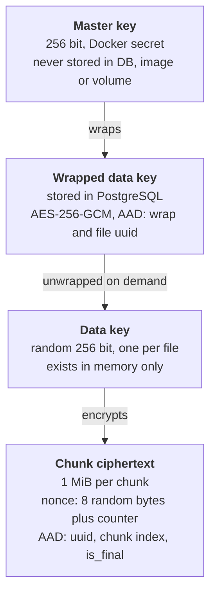

# Encryption design

| Item | Choice |
|---|---|
| Cipher | AES-256-GCM (`cryptography.hazmat.primitives.ciphers.aead.AESGCM`), authenticated encryption |
| Key hierarchy | A random 256-bit data key per file, wrapped with AES-256-GCM by the master key |
| Master key | Docker secret `/run/secrets/master_key` (or the `MASTER_KEY` environment variable in development), base64, validated at startup; never stored in the image, the database or the file volume |
| Chunking | 1 MiB of plaintext per chunk, so a 1 GB file needs about 2 MiB of RAM rather than 1 GB |
| Nonce (96 bit) | 8 random bytes (stored in the database) followed by a 32-bit chunk counter, unique per chunk |
| AAD per chunk | `file_uuid ‖ chunk_index (64-bit) ‖ is_final (1 byte)` |
| Wrapped-key AAD | `"wrap:" ‖ file_uuid` |
| Stored in the database | Base nonce, wrapped key, wrap nonce, sizes, chunk size and count, algorithm, master-key version |
| On disk | `<uuid>.enc` in a private volume, laid out as `chunk0 ‖ tag0 ‖ chunk1 ‖ tag1 ...`, with no header and no original name |

## Key hierarchy

## Design rationale

**Envelope encryption.** A per-file key limits the impact of a key compromise to one file and keeps the GCM
requirement of never reusing a (key, nonce) pair easy to satisfy. It also allows master-key rotation by
re-wrapping 48-byte keys (the `master_key_version` column) instead of re-encrypting stored data. Cloud KMS
services work the same way, so the master key could later move into a KMS or HSM without changing the file format.

**Nonce stored in the database.** Nonces must be unique, not secret. A database compromise alone yields wrapped
keys and nonces, which are useless without the master key, and a disk compromise alone yields only ciphertext.
Decryption requires the database, the secret and the volume together.

**Chunked encryption.** Encrypting a file in one GCM call requires the whole file in memory (1 GB per worker), and
GCM is limited to roughly 64 GiB per nonce. Chunking bounds memory use and makes the nonce scheme explicit.

**Nonce construction.** A random 96-bit nonce has a non-negligible collision probability after about 2^32 uses
under one key. Here every chunk under a key has a distinct counter value, so uniqueness holds by construction, and
the key is per-file in any case.

**Reordering, truncation and transplanting.** The chunk index is part of both the nonce and the authenticated
data, so moving chunk 3 to position 2 fails the tag check. The final chunk is sealed with `is_final=1`: if the
tail is dropped, the new last chunk was sealed with `is_final=0` and fails verification, and appended data fails
as well. The file UUID in the AAD prevents a valid chunk from being transplanted into another file. `tests.py`
contains a test for each case.

**No partial plaintext on failure.** Download is two-pass. Pass 1 authenticates every chunk and discards the
plaintext, using constant memory. Only if it succeeds does pass 2 stream-decrypt to the client. Pass 2
re-authenticates each chunk in case the file changed in between, and the response carries an exact
`Content-Length`, so an aborted stream appears to the client as an incomplete download and never as a complete,
shorter file. The cost is one extra sequential read and AES pass, which AES-NI makes inexpensive. Decrypting to a
temporary file first was rejected because it would place plaintext on disk.

**Plaintext never reaches disk.** The browser sends the raw file as the request body rather than multipart form
data, which Django would spool to `/tmp`. Nginx runs with `proxy_request_buffering off` and `proxy_buffering off`,
so it does not spool to its own temporary directory either. Django encrypts chunk by chunk directly into
`<uuid>.part` and then renames it atomically to `.enc`. The container root filesystem is read-only and `/tmp` is
a tmpfs.

**Deletion.** The database row is removed first, which destroys the wrapped key (crypto-shredding). Even if blocks
remain on disk or in a volume backup, they cannot be decrypted. The file is then unlinked.

**Master key as a Docker secret.** Environment variables are exposed through `docker inspect`,
`/proc/<pid>/environ`, crash dumps and child processes, whereas a secret is a file visible only to the container
that mounts it. With plain Compose the secret is a bind mount of `secrets/master_key.txt`, protected by host file
permissions; Swarm, Kubernetes or a KMS would give stronger guarantees.
